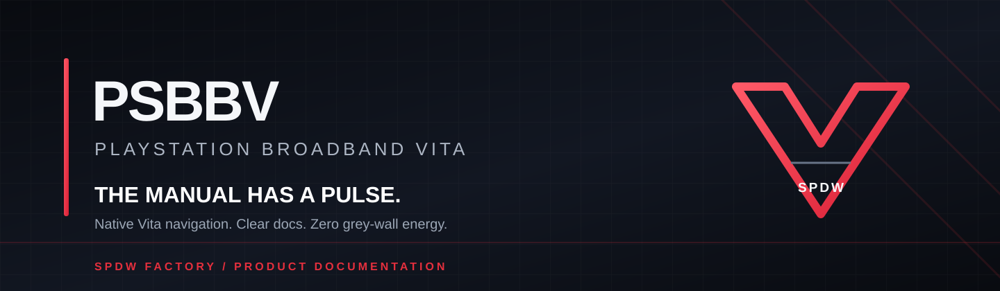

# 🛣️ THE ROADMAP

**What is real. What is next. What is still a nice idea.**

SPDW FACTORY · PROJECT TRACKER / 004

## 🚦 Status legend

| Marker | Meaning |
|---|---|
| ✅ | Implemented in the repository |
| 🟡 | Work started; verification or polish remains |
| 🔵 | Planned; not implemented |
| 🟠 | Needs target-hardware testing |
| ⛔ | Blocked by a named issue |

## Phase 0 — Native foundation

- [x] Product brief and architecture contract.
- [x] VitaSDK/CMake application target.
- [x] libvita2d render loop and system font baseline.
- [x] D-pad, Cross, Circle, and Start navigation.
- [x] Front touchscreen navigation.
- [x] Application menu with About and Exit actions.
- [x] Branded Home view and clearly labelled channel placeholders.
- [x] Initial SVG identity and Vita LiveArea package resources.
- [x] GitHub Actions VPK build workflow.
- [ ] 🟠 Confirm a green CI VPK build.
- [ ] 🟠 Install and test the VPK on a physical Vita.
- [ ] 🟠 Verify suspend/resume and resource recovery.

## Phase 1 — Make the UI feel finished

- [ ] Reusable panels, cards, labels, focus states, and layout primitives.
- [ ] Consistent transitions and focus restoration.
- [ ] Configurable confirm/back button mapping.
- [ ] Rear-touch behavior only where it has a clear purpose.
- [ ] Lightweight asset and texture cache.
- [ ] Frame pacing and memory measurements on hardware.

## Phase 2 — Give local content a proper home

- [ ] Typed metadata models for games and applications.
- [ ] Safe local content discovery.
- [ ] Empty, loading, unsupported, and error states.
- [ ] Sorting, filtering, and recently used views.
- [ ] Read-only discovery before adding launch or management flows.

## Phase 3 — Build the channels

- [ ] 🎮 Games
- [ ] 🧰 Applications
- [ ] 🌐 Network
- [ ] 🎵 Media
- [ ] ⬇️ Downloads
- [ ] ⚙️ System

Every channel needs a real data source, a failure model, and useful offline behavior before it gets a READY label.

## Phase 4 — Ship it properly

- [ ] Final production logo and complete LiveArea artwork.
- [ ] Settings and persistent preferences.
- [ ] Localization infrastructure; English remains the initial language.
- [ ] Compatibility and performance testing on hardware.
- [ ] Confirm the final VPK title ID.
- [ ] Release notes, checksums, and reproducible package build.

## 🧨 The release rule

A cross-build is not a hardware release. No version is called stable until the VPK installs and launches on real hardware, core navigation is tested, suspend/resume is checked, and CI is green.

---

**SPDW FACTORY** · PSBBV Roadmap  
Progress you can verify. Not just boxes you can tick.
